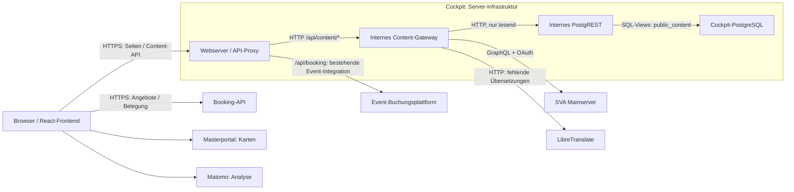

# Inhaltsquellen und Abrufwege

Stand: 12. November 2026, abgeglichen mit dem Code auf `dev` bei `1a15a84`. Diese Übersicht beschreibt die implementierten Abrufwege. Datenmengen, Abfragehäufigkeiten und laufende Produktivversionen wurden dafür nicht neu gemessen.

Das **interne Content-Gateway** führt die Inhalte für das Cockpit zusammen. Der **SVA Mainserver** liefert die wesentlichen dynamischen Fachinhalte. Die eigene **Cockpit-PostgreSQL** hält weiterhin Seitenstruktur, ergänzende Inhalte und Rückfalldaten vor und bleibt für den aktuellen Betrieb erforderlich.

## Überblick

Die Pfeile zeigen die Richtung der Abrufe; die Antworten laufen jeweils zurück.

Das Frontend ruft im Produktionspfad die Content-API unter der Cockpit-Adresse auf. Der Webserver leitet sie an das interne Gateway weiter. Der Gateway-Container veröffentlicht im Produktions-Compose keinen Host-Port. Build/Prerender und die Event-Statusprüfung des Webservers verwenden das Gateway ebenfalls intern.

Lokal kann das Frontend für Entwicklung direkt den veröffentlichten Gateway-Port nutzen. Diese lokale Konfiguration ist vom oben dargestellten Produktionspfad zu unterscheiden.

## Welche Inhalte kommen woher?

Die Endpunkte in der Tabelle beginnen mit `/api/content`.

| Inhalte | Endpunkt | Quelle und Abruf | Ergänzungen / Rückfall |
| --- | --- | --- | --- |
| Veranstaltungen und Termindetails | `/events`, `/events/:id` | Gateway → SVA Mainserver, GraphQL `eventRecords` / `eventRecord`, mit OAuth | Fehlende Sprachfassungen werden automatisch ergänzt. Die alte lokale Event-Datenbank ist nicht die Quelle dieses aktiven Pfads. |
| Orte / POIs und Details | `/pois`, `/pois/:id` | Gateway → SVA Mainserver, GraphQL `pointsOfInterest` / `pointOfInterest` | Öffentliche, gültig abbildbare POIs; Filterung und Paginierung im Gateway. |
| Hervorgehobene Projekte | `/featured-projects`, `/featured-projects/:id` | Gateway → SVA Mainserver, GraphQL `genericItems` mit `FeaturedProject` | Die Listenseite kombiniert Mainserver-Projekte mit Seitenmetadaten aus PostgreSQL. Details werden aus dem Mainserver geladen. |
| Dashboard-Kacheln | `/home`, `/dashboard`, `/public` | Gateway → SVA Mainserver, GraphQL `genericItems` mit `COCKPIT_CARD` | Dropdowns, Tabs, Zuordnung und lokale Ersatzkarten kommen aus PostgreSQL. Ohne zuordenbare Mainserver-Karten oder bei Abruffehlern bleiben lokale Karten erhalten. |
| Buchungs-FAQs | `/booking/faqs` | Gateway → SVA Mainserver, GraphQL `genericItems` mit `FAQ` | Sprachzuordnung und Ergänzung fehlender Übersetzungen im Gateway; lokale FAQ-Sprachdateien im Frontend als Rückfall. |
| Reguläre lokale Projekte, Schulen und Marktplatz | `/projects`, `/public` | Gateway → PostgREST → PostgreSQL, Views auf die lokalen Projektdaten | Von den Mainserver-Featured-Projects getrennte lokale Daten. Im Bundle unter `projects.items`, unter anderem mit `category=school` und `category=business`. |
| Seitentexte, SEO und Dashboard-Struktur | `/home`, `/dashboard`, `/public`; Metadaten von `/projects` und `/featured-projects` | Gateway → PostgREST → PostgreSQL, Seiten-, Dropdown-, Tab- und Link-Views | Die Struktur wird weiterhin lokal geladen, auch wenn die sichtbaren Kacheln aus dem Mainserver stammen. |
| Karten-Seitentexte | `/map` | Gateway → PostgREST → PostgreSQL | Die eigentliche Kartenanwendung kommt separat aus Masterportal. |
| Footer | `/footer` | Gateway → PostgREST → PostgreSQL | Sprachabhängige Ausgabe mit automatischer Übersetzung. |
| Booking-Tenant-Zuordnungen | `/booking-tenants` | Gateway → PostgREST → PostgreSQL | Das Repository ergänzt feste Tenant-Zuordnungen aus dem Code und entfernt doppelte Tenant-IDs. |
| Übersetzung öffentlich geladener Buchungstexte | `POST /translate` | Browser → Web-Proxy → Gateway → LibreTranslate | Antwort enthält vorhandene Übersetzungen oder zunächst Originaltexte. Keine Rückschreibung zum Mainserver. |

`/public` bündelt lokale Startseiten- und Projektinhalte und ergänzt Mainserver-Kacheln. Events, POIs und Buchungsangebote werden separat geladen. Vollständige Parameter und Antwortverträge: [Content-Gateway-API](content-gateway-api.md).

## Dienste außerhalb der Content-API

| Dienst | Abrufweg und Aufgabe |
| --- | --- |
| Booking-API | Der Browser lädt Angebote aus `/json/:tenant/bookables` und Belegung aus `/api/:tenant/bookables/:id/occupancy`. Das Buchungsziel wird aus `checkoutUrl` übernommen. |
| Bestehende Event-Buchungsplattform | Der Webserver bietet zusätzlich den `/api/booking`-Proxy zum konfigurierten `INTERNAL_BOOKING_URL` an. Dieser Weg gehört zur Event-Integration und ist vom Bookables-API-Pfad getrennt. |
| Masterportal | Der Browser bindet die externe Kartenanwendung ein. Lokale Karten-Seitentexte sind davon getrennt. |
| Matomo | Browserseitige Einbindung zur Nutzungsanalyse; keine Inhaltsquelle. |
| LibreTranslate | Das Gateway ergänzt fehlende Inhaltsübersetzungen. Der Browser benötigt keinen direkten Dienstzugang oder Übersetzungsschlüssel. |

## Rolle der Cockpit-PostgreSQL

„Lokal“ bezeichnet hier die **eigene Datenbank des Cockpit-Stacks** im Unterschied zum SVA Mainserver. Damit ist nicht ausschließlich eine Datenbank auf einem Entwicklerrechner gemeint. `stack.prod.yml` definiert weiterhin `guben-db-prod`; eine zusätzliche Entwicklerdatenbank lässt sich lokal über das Compose-Profil `local-db` starten.

Die Datenbank hat als Fachinhaltsquelle weniger Aufgaben als früher. Sie ist aber **kein reiner Cache und kein optionales Archiv**:

- Startseite und Dashboard laden zuerst ihre lokale Struktur. Mainserver-Kacheln werden anschließend zugeordnet.
- Lokale Projekte, Schulen, Marktplatz, Footer und ergänzende Seitentexte werden weiterhin daraus gelesen.
- Die Featured-Projects-Liste benötigt lokale Seitenmetadaten.
- Die Gateway-Readiness setzt sowohl funktionierendes PostgREST als auch einen erreichbaren Mainserver voraus.

Ein Ausfall von PostgreSQL/PostgREST kann daher zentrale Seiten und zusammengesetzte Antworten beeinträchtigen. Eigenständige Mainserver-Endpunkte haben zum Teil andere Abhängigkeiten; ein Datenbankausfall bedeutet nicht automatisch, dass jeder Gateway-Endpunkt ausfällt.

Für eine spätere Ablösung müssten die verbliebenen redaktionellen Inhalte in den SVA Mainserver übertragen oder anderweitig bereitgestellt werden. Struktur, Konfiguration und Rückfallverhalten benötigen ebenfalls einen Ersatz. Erst danach können Repository-Zusammensetzung, Readiness, Bootstrap und Deployment von PostgreSQL/PostgREST entkoppelt werden. Eine solche Migration ist mit dieser Dokumentation nicht umgesetzt.

## Cache, Aktualität und Fehlerverhalten

- **Mainserver-Inhalte:** validierter Cache pro Gateway-Prozess, vier Minuten frisch. Zusätzliche Event-/POI-Caches können die normale Aktualisierung auf etwa fünf Minuten verlängern. Bei fehlgeschlagener Aktualisierung darf die letzte gültige Antwort bis zu 24 Stunden ab letzter Validierung verwendet werden. Nach Neustart ist dieser Cache leer.
- **Übersetzungen:** vorhandene Übersetzungen oder Originaltext werden sofort ausgeliefert. Fehlende Übersetzungen werden im Hintergrund vorbereitet und können im Volume `translation-cache` gespeichert werden. `X-Translation-Pending` steuert das automatische Nachladen im Frontend. Details: [Inhaltsübersetzung](automatic-content-translation.md).
- **Readiness:** `/health/ready` prüft PostgREST und Mainserver unabhängig vom Mainserver-Content-Cache. Eine erfolgreiche Inhaltsantwort aus dem Cache belegt daher keine aktuelle Erreichbarkeit der Quelle.
- **Event-HTML:** Der Webserver prüft Events auch vor Auslieferung vorhandener Prerender-Dateien. Fehlende Events erhalten 404, eine nicht verfügbare Prüfung führt zu 503. Details: [Event-HTTP-Status](event-detail-http-status.md).

## Technische Referenzen

- [Gateway-Zusammensetzung und Readiness](../content-gateway/src/server.ts)
- [Kombination von Mainserver und lokalen Inhalten](../content-gateway/src/content/smart-village-postgrest-content-repository.ts)
- [Lokales Content-Repository](../content-gateway/src/content/postgrest-content-repository.ts)
- [PostgREST-Abfragen und Views](../content-gateway/src/content/postgrest-content-source.ts)
- [Webserver und interne Proxies](../frontend/docker/serve-dist.mjs)
- [Produktionsstack](../stack.prod.yml)
- [Systemdokumentation](system-documentation.md) und [Deploy-Runbook](deploy-runbook.md)

Technische Dateinamen, Variablen und Fehlerkennungen enthalten teilweise weiterhin `smart-village` oder `smartvillage`. In dieser Dokumentation heißt das angebundene System **SVA Mainserver**; bestehende Schnittstellenkennungen werden dadurch nicht umbenannt.
