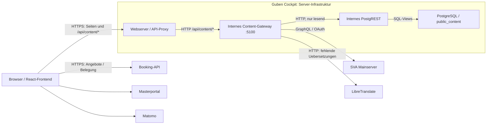

# Systemdokumentation

Stand: 12. November 2026; Repository `dev` bei `1a15a84`. Laufende Produktivversionen sind separat zu pruefen.

Diese Datei ist die kompakte technische Uebersicht des aktiven Public-Content-Stacks. Die vollstaendige Architekturbeschreibung liegt in der [arc42-Dokumentation](./arc42.md).

Die [Übersicht der Inhaltsquellen und Abrufwege](content-sources.md) zeigt, welche Inhalte der SVA Mainserver liefert und wofür die eigene Cockpit-PostgreSQL weiterhin benötigt wird.

Weiterfuehrende Betriebsdokumente:

- [Content-Gateway-API](./content-gateway-api.md)
- [Public Content Gateway Rollout](./public-content-gateway-rollout.md)
- [Deploy Runbook](./deploy-runbook.md)

## Zweck

Das Repository betreibt den oeffentlichen Web-Stack fuer `cockpit.guben.de` mit drei aktiven Kernbausteinen:

- `frontend/` fuer die React/Vite-Website
- `content-gateway/` als Fastify-API fuer `/api/content/*`
- `postgrest/` als read-only Datenzugriff auf PostgreSQL

Die fruehere `.NET`-Admin-/CMS-API (`guben-api-prod`) ist stillgelegt und aus dem produktiven Stack entfernt. PostgreSQL und PostgREST bleiben aktive Bestandteile des Public-Content-Pfads.

## Architektur auf einen Blick

Im Produktionspfad ruft das React-Frontend `/api/content/*` unter der oeffentlichen Cockpit-Adresse auf. Der Node-Webserver leitet diese Requests an das **interne Content-Gateway** weiter (`INTERNAL_CONTENT_GATEWAY_URL=http://content-gateway:5100`). Das Gateway kombiniert die Quellen, validiert die Antwortvertraege und uebernimmt Cache, Sprach-Fallback und Uebersetzungen. Es ist kein zusaetzlicher direkter Browserzugang zum SVA Mainserver erforderlich.

Build/Prerender und Event-Statuspruefungen des Webservers greifen ebenfalls intern auf das Gateway zu. Lokal kann das Frontend fuer Entwicklung direkt den veroeffentlichten Gateway-Port nutzen; `stack.prod.yml` veroeffentlicht diesen Port nicht am Host.

## Laufzeitkomponenten

| Komponente | Aufgabe | Standard-Port |
| --- | --- | --- |
| `web` | Build/Prerender beim Containerstart, Auslieferung ueber Node-Server | `3000` |
| `web-live` | interaktive Vite-Laufzeit fuer manuelle UI-Tests | `3300` |
| `content-gateway` | interner Dienst hinter dem Web-Proxy; liefert `/api/content/*`, Health und Metrics | `5100` |
| `postgrest` | interne read-only HTTP-Fassade auf `public_content` | `3001` extern, `3000` intern |
| `postgrest-bootstrap` | idempotentes SQL-Bootstrap fuer Rollen, Views und Checks | kein Port |
| `postgres` | optionale lokale DB aus diesem Repo | `55432` |
| `adminer` | Browser-Inspektion der DB | `8080` |

## Oeffentliche HTTP-Schnittstellen

### Gateway

- `GET /health`
- `GET /health/live`
- `GET /health/ready`
- `GET /metrics`
- `GET /api/content/home`
- `GET /api/content/dashboard`
- `GET /api/content/projects`
- `GET /api/content/featured-projects`
- `GET /api/content/featured-projects/:id`
- `GET /api/content/pois`
- `GET /api/content/pois/:id`
- `GET /api/content/public`
- `GET /api/content/events`
- `GET /api/content/events/:id`
- `GET /api/content/map`
- `GET /api/content/footer`
- `GET /api/content/booking-tenants`
- `GET /api/content/booking/faqs`
- `POST /api/content/translate` (Uebersetzung oeffentlicher Buchungstexte)

Wichtige Query-Parameter:

- `lang` fuer alle sprachabhaengigen Inhalte; ohne Parameter wird zuerst `Accept-Language`, danach `DEFAULT_LANGUAGE` verwendet
- `pageNumber` und `pageSize` fuer paginierte Listen
- bei Events zusaetzlich `title`, `category`, `startDate`, `endDate`, `sortBy`, `ordering`, `distance`
- bei POIs zusaetzlich `search`, `categoryIds` (mehrfach oder kommasepariert), `location`, `radius`, `sort=name|updatedAt` und `direction=asc|desc`

### Quellen je Inhaltsbereich

| Gateway-Inhalt | Primaerquelle | Verhalten und Fallback |
| --- | --- | --- |
| `/events`, `/events/:id` | SVA Mainserver `eventRecords` / `eventRecord` | serverseitig per OAuth und GraphQL |
| `/pois`, `/pois/:id` | SVA Mainserver `pointsOfInterest` / `pointOfInterest` | nur aktive und sichtbare, gueltig abbildbare POIs; Filterung und Paginierung erfolgen im Gateway |
| `/featured-projects`, `/featured-projects/:id` | SVA Mainserver `genericItems(genericType: "FeaturedProject")` | Listenseiten-Metadaten kommen weiterhin aus PostgREST; ausgeliefert werden nur sichtbare und als publiziert markierte Items |
| `/booking/faqs` | SVA Mainserver `genericItems(genericType: "FAQ")` | Filterung nach `payload.languageCode`; das Frontend behaelt seine lokalen Sprachdateien als Fallback fuer leere, ungueltige oder nicht erreichbare API-Antworten |
| `/home`, `/dashboard`, `/public` – Kacheln | SVA Mainserver `genericItems(genericType: "COCKPIT_CARD")` | PostgREST liefert Dropdown-/Tab-Struktur und lokale Karten. SVA-Mainserver-Karten werden sprach- und kategoriebasiert zugeordnet; wenn keine Karte zugeordnet werden kann oder der Abruf fehlschlaegt, bleiben alle lokalen Karten erhalten. |
| `/projects` sowie sonstige Bereiche von `/home`, `/dashboard`, `/public` | PostgREST | regulaere Projekte bleiben in PostgreSQL; im Public Bundle liegen Schulen und Marktplatz-Unternehmen gemeinsam unter `projects.items` mit `category=school` beziehungsweise `category=business` |
| `/map`, `/footer`, `/booking-tenants` | PostgREST | keine SVA-Mainserver-Anreicherung |

`/api/content/public` ist der gebuendelte, fuer einfache Datenabfragen geeignete Endpunkt. Seine Dashboard-Karten stehen flach unter `home.cards`; die vollstaendige Dropdown-/Tab-Struktur liefern `/api/content/home` und `/api/content/dashboard`.

Uebersetzungen werden serverseitig im Hintergrund ergaenzt. `X-Translation-Pending` signalisiert ausstehende Texte; das Frontend laedt diese Antworten automatisch nach. Konfiguration, Grenzen und persistenten Cache beschreibt die [Uebersetzungsdokumentation](automatic-content-translation.md).

### PostgREST

PostgREST ist keine Browser-API. Der Dienst wird nur intern zwischen Gateway und Datenbank verwendet und exponiert das Schema `public_content` ueber die read-only Rolle `guben_public_content_reader`.

## Vertraege und Konfiguration

- Gemeinsame JSON-Vertraege liegen in [shared/public-content/contracts.ts](../shared/public-content/contracts.ts).
- Das Frontend prueft die Gateway-Vertraege zusaetzlich ueber `frontend/scripts/verify-gateway-contracts.ts`.
- Das Gateway kennt nur `CONTENT_SOURCE_MODE=mock` und `CONTENT_SOURCE_MODE=postgrest`.
- Das Frontend schaltet Public Content ueber `VITE_PUBLIC_CONTENT_SOURCE=gateway|disabled`.
- PostgREST verwendet konsistent `PGRST_DB_SCHEMAS=public_content`.
- Im Modus `postgrest` sind `SV_GRAPHQL_URL`, `SV_OAUTH_TOKEN_URL`, `SV_CLIENT_ID` und `SV_CLIENT_SECRET` gemeinsam verpflichtend. Die Zugangsdaten bleiben ausschliesslich im Gateway; der Browser greift nicht direkt auf SVA Mainserver GraphQL zu.

### SVA-Mainserver-Read-Cache

Validierte GraphQL-Antworten werden pro Gateway-Prozess zwischengespeichert. Erfolgreiche Antworten sind vier Minuten frisch; die zusaetzlichen einminuetigen Repository-Caches fuer Events und POIs koennen die normale Sichtbarkeit einer Aenderung auf ungefaehr fuenf Minuten verlaengern. Scheitert eine Aktualisierung, darf die letzte fachlich gueltige Antwort bis zu 24 Stunden nach ihrer letzten erfolgreichen Validierung weiterverwendet werden.

Cache und laufende Requests werden nicht zwischen Gateway-Prozessen geteilt und sind nach Neustart oder Deployment leer. `/health/ready` umgeht den Content-Cache und prueft PostgREST sowie SVA Mainserver live.

## Betrieb

- Der Standard-Compose-Stack nutzt standardmaessig eine bereits laufende Host-PostgreSQL ueber `host.docker.internal`.
- Eine lokale Compose-PostgreSQL wird nur ueber `--profile local-db` zugeschaltet.
- Der produktive Rollout verwendet `stack.prod.yml` mit vier Services: Web, Gateway, PostgREST und PostgreSQL 17. Lokal wird optional PostgreSQL 16 verwendet.
- `VERSION_WEB` waehlt Gateway und standardmaessig Frontend; `VERSION_FRONTEND` kann das Frontend separat festlegen. Vor normalen Releases den Override pruefen.
- Die vier Container schreiben in den Journal-Namespace `guben-cockpit` mit maximal 14 Tagen Aufbewahrung und 4 GiB Groessenlimit; Details im Deploy-Runbook.
- Der Node-Webserver prueft Event-Details auch bei vorhandenen Prerender-Dateien auf 404/503 und leitet alte numerische Projektlinks nach `/projects` um.
- Die Versions-/Release-Schritte stehen im [Release-Verfahren](releases.md).

## Referenzen

- [arc42-Architekturdokumentation](./arc42.md)
- [Public Content Gateway Rollout](./public-content-gateway-rollout.md)
- [Deploy Runbook](./deploy-runbook.md)
